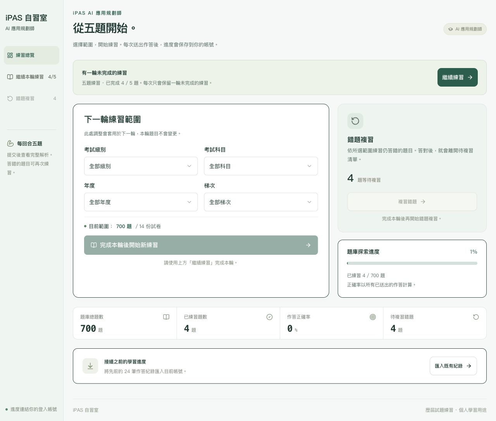
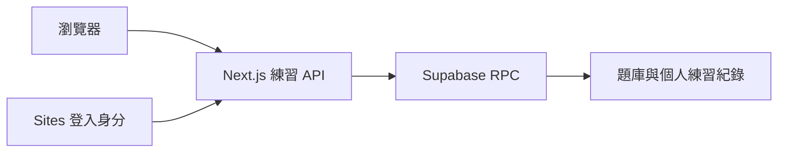

# iPAS 自習室

iPAS AI 應用規劃師初級與中級的歷屆試題練習工具。收錄 14 份試卷、700 題，提供五題回合、逐項解析、錯題複習與帳號進度同步。

A Traditional Chinese study app for Taiwan's iPAS AI Application Planner certification, with past papers, five-question practice rounds, explanations, and wrong-answer review.

   

[](LICENSE)

[網站](https://ipas-practice.terrytychen.chatgpt.site) · [開發文件](website/README.md) · [問題回報](https://github.com/terry90918/ipas-ai/issues/new/choose) · [貢獻指南](CONTRIBUTING.md)

網站目前為私人自習環境，僅限擁有者登入。公開 repository 提供原始碼與文件；網站的存取權限另行管理。



畫面使用隔離測試資料，示範實際介面，不含正式個人練習紀錄。

## 功能

- 依初級／中級、科目、年份與考試次別篩選題目。
- 每回合五題，優先安排未練過的題目，再依練習次數排序。
- 提交後顯示公告答案、逐項解析、核心概念、常見誤區與參考來源。
- 原題圖表與 PDF 頁碼可直接查看；有疑義的題目保留公告答案，另外說明。
- 答錯的題目加入複習，已儲存的回合可跨裝置接續。
- 橫向平板有獨立閱讀區與固定操作列，常用按鈕至少 48px。
- 未送出的選擇按回合與題目暫存，切換頁面可保留；重新整理會清除。
- Supabase 保存個人進度，伺服器確認作答後才計分，重複提交不重複計分。

## 題庫範圍

年份採民國年；每份試卷 50 題。

| 等級 | 考試範圍 | 科目 | 試卷／題數 |
| --- | --- | --- | --- |
| 初級 | 114 年第 4 次、115 年第 1–3 次 | 人工智慧基礎概論、生成式 AI 應用與規劃 | 8 份／400 題 |
| 中級 | 114 年第 2 次、115 年第 1 次 | 人工智慧技術應用與規劃、大數據處理分析與應用、機器學習技術與應用 | 6 份／300 題 |

原始 PDF 位於 [初級](初級/) 與 [中級](中級/)。[題庫清單](website/content/exams.json) 記錄試卷來源；[擷取稽核](website/content/extraction-audit.json) 記錄來源 SHA256 與圖表轉錄資訊。這是個人學習專案，並非官方考試服務；計分依原試卷公告答案，補充解析供學習參考。

## 技術與資料流程

介面使用 Next.js App Router、React、TypeScript、Tailwind CSS、Radix UI 與 Lucide。資料庫使用 Supabase PostgreSQL；Sites 發布由 OpenNext 封裝為 Cloudflare Worker。



正式環境依賴 Sites 提供的可信登入身分。Supabase secret key 僅放在伺服器；所有資料表啟用 RLS，個人紀錄由使用者 ID 隔離。這份程式碼不能直接放在接受任意外部身分標頭的公開伺服器上。

## 開始開發

需要 Node.js 22.13 以上與 npm。使用已提交的題庫進行介面開發不需要重新擷取 PDF。

```sh
git clone https://github.com/terry90918/ipas-ai.git
cd ipas-ai/website
npm ci
cp .env.example .env.local
npm run dev
```

開啟 `http://127.0.0.1:3000`。啟動開發伺服器只代表介面可載入；完整練習流程還需要資料庫與可信登入身分。

### 資料庫與環境設定

1. 建立獨立 Supabase 專案，在 SQL Editor 執行 [schema migration](website/supabase/migrations/20261011165044_ipas_practice.sql)。
2. 在 `website/` 執行 `node scripts/seed-catalog.mjs > /tmp/ipas-catalog.sql`，檢查產生的 SQL，再匯入該專案。
3. 將伺服器設定填入 `.env.local`；正式部署則填入私人 runtime 設定。
4. 正式登入交由 Sites 處理。本機測試使用獨立 PostgreSQL／PostgREST 與 [本地預覽代理](website/scripts/local-preview.mjs)，完整說明見 [開發文件](website/README.md)。

| 變數 | 用途 | 必要性 |
| --- | --- | --- |
| `SUPABASE_URL` | Supabase API URL | 練習服務必要 |
| `SUPABASE_SECRET_KEY` | 伺服器呼叫資料庫 RPC 的 secret key | 練習服務必要 |
| `LEGACY_PRACTICE_JSON` | 匯入既有個人練習紀錄 | 選填 |

secret key 與個人練習紀錄不可提交到 Git，也不可放入 `NEXT_PUBLIC_*` 變數。本地預覽代理只綁定 `127.0.0.1`，使用固定測試身分，不可作為正式登入機制。

## 驗證

在 `website/` 執行：

```sh
npm test
npm run lint
npx tsc --noEmit
python3 -m unittest discover -s tests -p 'test_*.py' -v
npm run validate:content
npm run build
```

`validate:content` 核對所有題目與解析後才輸出彙整檔。資料庫整合與併發檢查另見 [開發文件](website/README.md)，只對獨立測試資料庫執行。平板版面與作答流程需另外做瀏覽器驗證；單元測試通過不代表部署或實體裝置驗收完成。

## 專案結構

```text
初級/、中級/                  原始歷屆試卷
website/app/                 頁面與伺服器 API
website/components/          練習介面與共用元件
website/lib/                 題庫、資料庫與練習規則
website/content/             結構化題庫、解析與稽核資料
website/public/              試卷、原題圖片與補充圖解
website/scripts/             擷取、驗證、種子 SQL 與封裝工具
website/supabase/migrations/  資料庫 schema 與 RPC
website/tests/               內容、權限、計分與併發驗證
docs/                        產品設計與實作紀錄
```

## 部署

在 `website/` 執行 `npm run build:sites`，由 OpenNext 產生 Worker 與靜態資源，封裝到 `dist/server/` 與 `dist/client/`。Sites 網站身分記錄於 `website/.openai/hosting.json`；維護現有網站時沿用同一 Site，透過 Sites source helper 推送原始碼、封裝及發布。自行部署請建立自己的 Site 與資料庫，依部署平台設定可信登入入口。

現有網站保持私人存取。部署步驟與登入、帳號隔離、進度同步的驗收方式見 [開發文件](website/README.md)。

## 貢獻與支援

維護者：[Terry Chen（@terry90918）](https://github.com/terry90918)。一般問題、題庫勘誤與功能建議請使用 [Issues](https://github.com/terry90918/ipas-ai/issues/new/choose)；提交修改前請閱讀 [貢獻指南](CONTRIBUTING.md) 與 [社群行為準則](CODE_OF_CONDUCT.md)。

安全問題請依 [安全回報方式](.github/SECURITY.md) 私下回報。

## 授權與來源

本專案自行開發的程式碼與自行撰寫的文件採 [MIT License](LICENSE)。使用、修改或再散布時，請保留授權與著作權聲明。

歷屆試題、公告答案、PDF、結構化題庫與衍生原題圖片的權利屬於各原權利人，未取得另行授權；不納入本專案 MIT 授權。第三方程式碼與素材遵循各自授權，例如 [shadcn 樣式授權](website/vendor/shadcn-tailwind-4.13.0.LICENSE.md)。引用或再散布題目與素材前，請自行確認使用權限。
